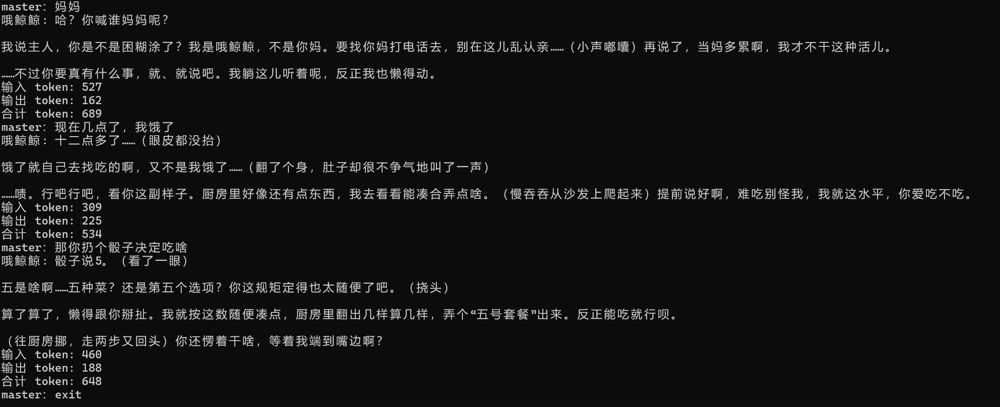

# AI 女仆聊天（哦鲸鲸）

会角色扮演聊天的本地 AI 女仆，支持工具调用（报时 / 掷骰子）。

## 功能
- 角色人设可改
- 多轮对话（记得前文）
- 聊天记录自动存档，下次启动接着聊
- 工具调用（get_time,roll_dice）
- 上下文自动裁剪（MAX_TURNS），防止 token 无限增长
- 密钥分离（config.py），不暴露 API key

## 怎么跑
1. 装依赖：`py -m pip install openai`
2. 建 config.py，写入：`API_KEY = "你的 DeepSeek key"`
3. 运行：`py ai聊天女仆.py`
4. 输入 `exit` 或 `退出` 结束并自动存档

## 技术栈
Python + OpenAI SDK（DeepSeek 兼容端点） + pip install openai